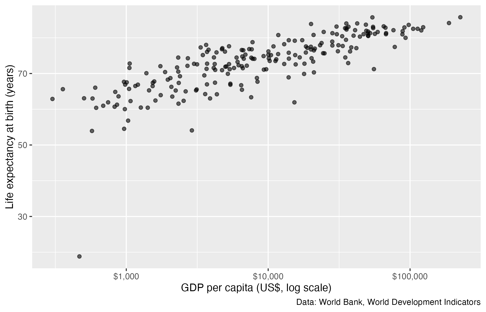

## Introduction

in progress

```{r, loading-libraries-and-functions}
#| message: false
#| warning: false
#| include: false

# libraries and functions
library(here)
library(ggplot2)
library(dplyr)
source(here("pages", "project", "src", "functions", "save_plot_as_png.R"))
```

```{r, getting-data}
#| message: false
#| warning: false
#| include: false

# run the cleaning script (removes aggregates, keeps needed variables,
# drops missing values, and saves the cleaned file)
source(here("pages", "project", "src", "data", "data_cleaning.R"))

# read the cleaned World Bank data
world_bank <- readRDS(
  file = here("pages", "project", "data", "cleaned", "world_bank_cleaned.Rds")
)
```

## The General Pattern

```{r, plot-gdp-life-expectancy}
#| echo: false
#| message: false
#| warning: false

# GDP per capita vs. life expectancy for one recent year
gdp_life_plot <-
  world_bank |>
  filter(
    year == 2022
  ) |>
  ggplot(
    data = _,
    mapping = aes(
      x = gdp_per_capita,
      y = life_expectancy
    )
  ) +
  # one point per country
  geom_point(
    alpha = 0.6
  ) +
  # log scale so poor and rich countries are both visible
  scale_x_log10(
    labels = scales::label_dollar()
  ) +
  labs(
    x = "GDP per capita (US$, log scale)",
    y = "Life expectancy at birth (years)",
    caption = "Data: World Bank, World Development Indicators"
  )
```

```{r, saveplot-gdp-life-expectancy}
#| message: false
#| warning: false
#| include: false

# save the plot as a .png file
save_plot_as_png(
  plot = gdp_life_plot,
  file_name = "gdp-life-expectancy-2022.png"
)
```

{width=80% fig-alt="in progress"}

in progress

## Exceptions to the Pattern

in progress

## Summary

in progress

## References

- World Bank. World Development Indicators. Retrieved with the {WDI} R package.

## Integrity Statement

in progress
